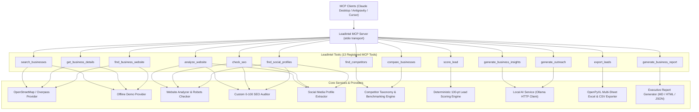

# LeadIntel

> **Free, open-source, local-first Model Context Protocol (MCP) server and Python library for AI-powered business intelligence and B2B lead generation.**

[](https://opensource.org/licenses/MIT)
[](https://www.python.org/downloads/)
[](https://modelcontextprotocol.io/)
[](https://docs.astral.sh/uv/)

LeadIntel empowers AI assistants — such as Claude Desktop, Google Antigravity, and other MCP-compatible clients — to discover businesses, audit websites, benchmark competitors, evaluate deterministic lead scores, run local AI strategic insights via Ollama, export publication-grade multi-sheet Excel spreadsheets, and generate executive business intelligence reports.

---

## Core Principles

- **100% Free & Open-Source**: Licensed under the permissive MIT License.
- **Local-First Architecture**: No mandatory paid APIs, no mandatory API keys, no billing accounts, and no subscriptions.
- **Deterministic Lead Scoring**: Transparent, evidence-based scoring models (0–100) that distinguish verified gaps from unavailable information without arbitrary penalties.
- **Strict Privacy**: Zero telemetry, zero cloud AI exfiltration. Optional AI uses local Ollama instances (`http://localhost:11434`).
- **Ethical & Compliant**: Adheres to OpenStreetMap ODbL 1.0 licensing, respects website `robots.txt` rules, prevents private personal data harvesting, and provides comprehensive SSRF and path traversal protections.

---

## Architecture

LeadIntel is structured into clean, decoupled layers:



---

## Registered MCP Tools

LeadIntel provides 13 registered MCP tools:

| # | Tool Name | Description | Key Inputs |
|---|---|---|---|
| 1 | `search_businesses` | Discover local businesses via OpenStreetMap / Overpass API with automatic demo fallback | `query`, `location`, `category`, `limit` |
| 2 | `get_business_details` | Retrieve full coordinates, address, and contact details for a specific business | `business_id` |
| 3 | `find_business_website` | Discover and verify official websites using search heuristics and OSM tags | `business_name`, `location`, `category` |
| 4 | `analyze_website` | Audit web availability, HTTPS, SSL validity, viewport, headings, and broken links | `url`, `check_broken_links` |
| 5 | `check_seo` | Deterministic 100-point on-page SEO audit (titles, metas, H1s, alt tags, robots.txt, sitemaps) | `url` |
| 6 | `find_social_profiles` | Extract verified official profiles (LinkedIn, X/Twitter, Facebook, Instagram, YouTube, Pinterest) | `url` |
| 7 | `find_competitors` | Discover geographically and categorically relevant industry competitors | `business_name`, `business_category`, `city`, `state` |
| 8 | `compare_businesses` | Side-by-side benchmark comparison between target business and industry rivals | `target_business`, `competitors` |
| 9 | `score_lead` | Deterministic 100-point lead qualification assessing website quality, SEO, social, and mobile gaps | `business_name`, `website_analysis`, `seo_audit`, `social_profiles` |
| 10 | `generate_business_insights` | Local AI business analysis, opportunity explanations, and service recommendations via Ollama | `business_name`, `lead_score_data`, `website_analysis` |
| 11 | `generate_outreach` | Local AI multi-channel outreach pitches (Cold Email, LinkedIn connection, WhatsApp message) | `business_name`, `service_focus`, `contact_name` |
| 12 | `generate_business_report` | Multi-format executive intelligence report (Markdown, styled HTML, or JSON) across 12 sections | `business_info`, `lead_score_data`, `output_format` |
| 13 | `export_leads` | Search and export leads to multi-sheet formatted Excel (`.xlsx`), CSV, or JSON | `query`, `location`, `format`, `output_path` |

---

## Requirements

- **Python**: 3.11 or newer
- **uv**: Modern, high-speed Python package manager ([install uv](https://docs.astral.sh/uv/))
- **Operating System**: macOS, Linux, or Windows
- **(Optional) Ollama**: Locally installed [Ollama](https://ollama.ai) for local AI features

---

## Installation

```bash
# 1. Clone the repository
git clone https://github.com/example/leadintel.git
cd leadintel

# 2. Sync dependencies using uv
uv sync

# 3. Create environment configuration (optional)
cp .env.example .env
```

---

## MCP Client Configuration

### Claude Desktop Setup

Add LeadIntel to your Claude Desktop configuration file:

- **macOS**: `~/Library/Application Support/Claude/claude_desktop_config.json`
- **Windows**: `%APPDATA%\Claude\claude_desktop_config.json`
- **Linux**: `~/.config/Claude/claude_desktop_config.json`

```json
{
  "mcpServers": {
    "leadintel": {
      "command": "uv",
      "args": [
        "--directory", "/ABSOLUTE/PATH/TO/leadintel",
        "run", "leadintel-server"
      ]
    }
  }
}
```

### Google Antigravity Setup

Add LeadIntel to your Antigravity project configuration:

```json
{
  "mcpServers": {
    "leadintel": {
      "command": "uv",
      "args": [
        "--directory", "/ABSOLUTE/PATH/TO/leadintel",
        "run", "leadintel-server"
      ],
      "env": {
        "LOG_LEVEL": "INFO"
      }
    }
  }
}
```

---

## Optional Local AI Setup (Ollama)

LeadIntel includes zero-cost, local AI capabilities via [Ollama](https://ollama.ai):

```bash
# 1. Install and start Ollama
ollama serve

# 2. Pull a recommended lightweight model
ollama pull llama3

# 3. Enable in .env
OLLAMA_ENABLED=true
OLLAMA_BASE_URL=http://localhost:11434
OLLAMA_MODEL=llama3
```

> **Privacy Guarantee**: All prompts are sent exclusively to your local loopback interface (`http://localhost:11434`). No business data or prompt information is sent to third-party cloud providers.

---

## Usage Examples

### 1. Discover Businesses & Export to Multi-Sheet Excel
Ask your AI assistant:
> *"Search for dental clinics in Austin, TX and export them to an Excel workbook."*

Or invoke the tool directly:
```python
await mcp.call_tool("export_leads", {
    "query": "dental clinic",
    "location": "Austin, TX",
    "format": "excel",
    "limit": 20
})
```

The resulting Excel workbook includes 7 dedicated worksheets:
1. **Dashboard Summary**: Aggregate KPI cards, lead priority distribution, and industry mix.
2. **Business Leads**: Address, contact information, phone, email, website, and data attribution.
3. **Website Audit**: Availability, HTTPS status, load time, mobile viewport, and contact forms.
4. **Competitor Intelligence**: Local competitors, category specialization, and confidence metrics.
5. **Lead Scoring**: Overall 100-pt score, priority tier, and evidence completeness percentage.
6. **AI Insights**: Executive summaries and strategic service opportunities.
7. **Outreach**: Multi-channel draft templates for emails, LinkedIn, and WhatsApp.

### 2. Website & SEO Diagnostic Audit
> *"Audit the website and technical SEO health for https://example.com."*

```python
# Analyze technical performance and structure
website_data = await mcp.call_tool("analyze_website", {"url": "https://example.com"})

# Perform 0-100 technical SEO evaluation
seo_data = await mcp.call_tool("check_seo", {"url": "https://example.com"})
```

### 3. Generate Executive Business Intelligence Report
> *"Create a comprehensive business research report for Apex Solar in Denver, CO in HTML format."*

```python
report_html = await mcp.call_tool("generate_business_report", {
    "business_info": {
        "name": "Apex Solar Solutions",
        "category": "Solar Energy Equipment",
        "city": "Denver",
        "state": "CO",
        "website": "https://apexsolar.example"
    },
    "output_format": "html"
})
```

---

## Screenshots Placeholder

```
+--------------------------------------------------------------------------+
|                       LeadIntel Dashboard (Excel Export)                 |
+--------------------------------------------------------------------------+
|  Total Businesses: 50  |  High Priority: 14  |  Avg Lead Score: 72/100   |
+--------------------------------------------------------------------------+
|  [Sheet 1: Dashboard] [Sheet 2: Leads] [Sheet 3: Website Audit] ...      |
+--------------------------------------------------------------------------+
|  (Interactive screenshots will be published with the v0.1 release)       |
+--------------------------------------------------------------------------+
```

---

## Security & Ethical Safeguards

- **SSRF & DNS Rebinding Mitigation**: Strict validation against loopback, private subnets (RFC 1918), carrier-grade NAT (RFC 6598), and cloud instance metadata (`169.254.169.254`, `fd00:ec2::254`, `metadata.google.internal`). All HTTP redirects are validated before being followed.
- **Path Traversal Protection**: Export file paths are sanitized against traversal sequences (`..`), null bytes, and sensitive system directories (`/etc`, `/usr`, `~/.ssh`).
- **Spreadsheet Formula Injection Prevention**: Cell contents starting with `=`, `+`, `-`, `@`, `\t`, or `\r` are sanitized with leading text escapes.
- **HTML Injection Defense**: Stored XSS defense using strict entity escaping across all dynamic fields in HTML executive reports.
- **ODbL License Attribution**: Data retrieved from OpenStreetMap contributors is attributed in accordance with the Open Database License.

---

## Limitations

- **Search Coverage**: Business discovery relies on OpenStreetMap and Nominatim data, which may vary in coverage density depending on geographic region and country.
- **On-Page Technical SEO**: The `check_seo` tool evaluates on-page technical factors and source standards. It does not replicate proprietary search engine ranking algorithms or backlinks.
- **Deterministic Lead Scoring**: Lead scores evaluate observable digital presence gaps to identify service opportunities. They do not predict commercial budget or purchasing authority.

---

## License

LeadIntel is free and open-source software licensed under the **[MIT License](LICENSE)**.
OpenStreetMap data is © [OpenStreetMap contributors](https://www.openstreetmap.org/copyright) licensed under the [Open Database License (ODbL 1.0)](https://opendatacommons.org/licenses/odbl/).
